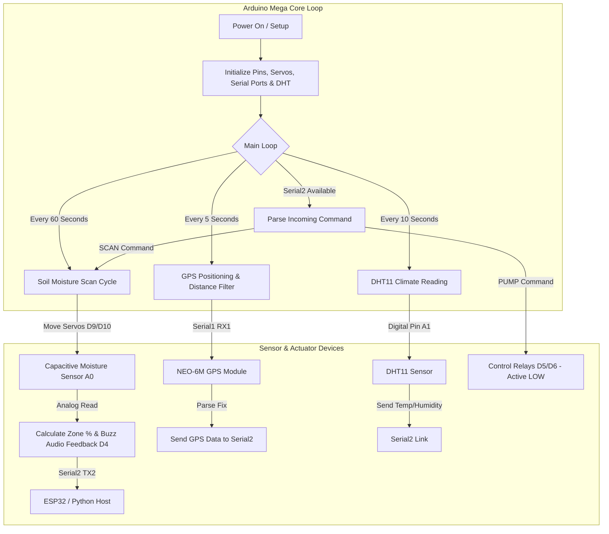
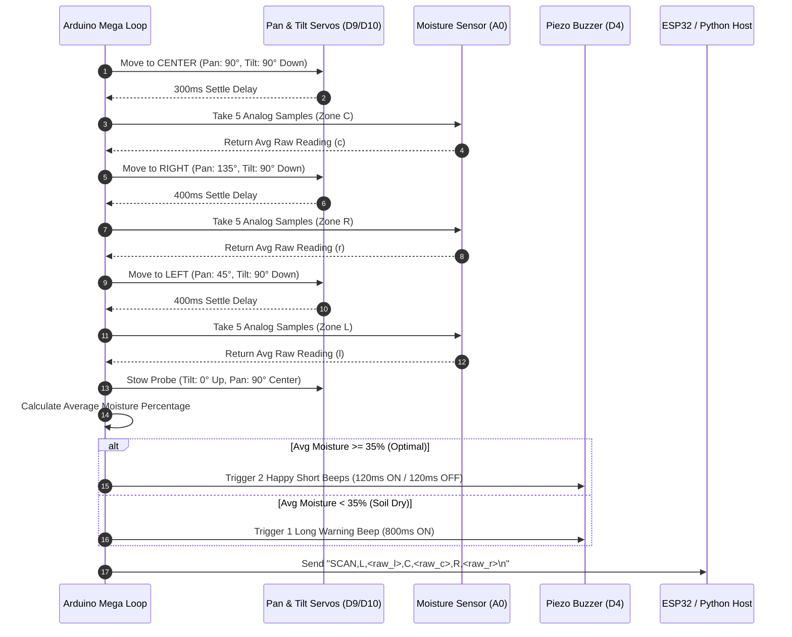

# Arduino Mega Soil Scanner & Control Workflow Specification

## 1. System Overview & Architecture

The `arduino_soil_scanner.ino` firmware acts as the primary hardware controller for the Farm Rover platform. Executing on an **Arduino Mega 2560**, it coordinates multi-zone soil moisture scanning using a Pan/Tilt dual-servo assembly, environment monitoring (DHT11 temperature & humidity), satellite positioning (NEO-6M GPS), audio alert diagnostics (Buzzer), and irrigation water pump relay controls.



### ASCII Logic & Block Diagram

```text
=========================================================================================================
                          ARDUINO MEGA SOIL SCANNER HARDWARE & LOGIC BLOCK DIAGRAM
=========================================================================================================

                                    +---------------------------+
                                    |    POWER ON & SETUP()     |
                                    | - Serial 0, 1, 2 @ 9600   |
                                    | - Attach Servos D9, D10   |
                                    | - Set Relay/Buzzer Output |
                                    +-------------+-------------+
                                                  |
                                                  v
                                    +---------------------------+
                                    |     MAIN LOOP() EXEC      |
                                    |  Continuous non-blocking  |
                                    +-------------+-------------+
                                                  |
    +-----------------------+---------------------+-----------------------+-----------------------+
    |                       |                                             |                       |
    v                       v                                             v                       v
+-------+               +-------+                                     +-------+               +-------+
| TIMER |               | TIMER |                                     | TIMER |               | RX2   |
| 60 SEC|               | 5 SEC |                                     | 10 SEC|               | CHECK |
+---+---+               +---+---+                                     +---+---+               +---+---+
    |                       |                                             |                       |
    v                       v                                             v                       v
+------------------+    +--------------------+                    +-------------------+    +--------------------+
|  MOISTURE SCAN   |    |    GPS SAMPLING    |                    |   DHT11 READ      |    | SERIAL2 COMMAND    |
|  PROBE SWEEP     |    | (Serial1 / NEO-6M) |                    |  (Digital Pin A1) |    | (ESP32/Python Link)|
+--------+---------+    +---------+----------+                    +---------+---------+    +---------+----------+
         |                        |                                         |                        |
         v                        v                                         v                        v
+------------------+    +--------------------+                    +-------------------+    +--------------------+
| SERVO MOVEMENT   |    | HAS FIX & MOVED    |                    | READ TEMP & HUMID |    | COMMAND DISPATCHER |
| Center->Right->  |    |     >= 1 METRE?    |                    | (Check if NaN)    |    | (Parse String \n)  |
| Left->Stow Probe |    +---------+----------+                    +---------+---------+    +---------+----------+
+--------+---------+              |                                         |                        |
         |                   +----+----+                                    v           +------------+------------+
         v                   |         |                             +--------------+   |                         |
+------------------+       YES         NO                            | FORMAT DATA  |   v                         v
| ANALOG SAMPLING  |         |         |                             | DHT,temp,hum | +------------------+  +-------------------+
| A0 Sensor Read   |         v         v                             +--------------+ | IF CMD == "SCAN" |  | IF CMD == "PUMP*" |
| (5 Samples Avg)  |     +-------+   +-------+                              |         +--------+---------+  +---------+---------+
+--------+---------+     | FORMAT|   | SKIP  |                              v                  |                    |
         |               |  GPS  |   | SEND  |                        +--------------+         v                    v
         v               +---+---+   +-------+                        | SEND SERIAL2 | +------------------+  +-------------------+
+------------------+         |                                        | "DHT,t,h\n"  | | RUN MOISTURE     |  | SET RELAYS D5/D6  |
| CONVERT RAW TO % |         v                                        +--------------+ | SCAN CYCLE       |  | Active LOW (LOW=ON|
| (600->0, 280->100|     +-------+                                                     +------------------+  | HIGH=OFF)         |
+--------+---------+     | SEND  |                                                                            +-------------------+
         |               |SERIAL2|
         v               +-------+
+------------------+
| AUDIO FEEDBACK   |
| Avg >= 35%:      |
|   2 Happy Beeps  |
| Avg < 35%:       |
|   1 Warning Beep |
+--------+---------+
         |
         v
+------------------+
| SEND SERIAL2     |
| SCAN,L,c,C,c,R,r |
+------------------+
=========================================================================================================
```

---

## 2. Hardware Pinout & Wiring Specifications

| Hardware Component | Arduino Mega Pin | Signal Type | Operating Mode / Active State |
| :--- | :--- | :--- | :--- |
| **Pan Servo (Left/Right)** | `D9` | PWM Output | 45° (Left), 90° (Center), 135° (Right) |
| **Tilt Servo (Up/Down)** | `D10` | PWM Output | 0° (Up / Stowed), 90° (Down / Probe In Soil) |
| **Capacitive Moisture Sensor** | `A0` | Analog Input | 600 (Dry Air = 0%) to 280 (Water = 100%) |
| **DHT11 Climate Sensor** | `A1` | Digital Signal | OneWire digital telemetry read |
| **Piezo Audio Buzzer** | `D4` | Digital Output | Active HIGH (Good: 2 Beeps, Warning: 1 Beep) |
| **Pump Relay LEFT (IN1)** | `D5` | Digital Output | **Active LOW** (LOW = ON, HIGH = OFF) |
| **Pump Relay RIGHT (IN2)** | `D6` | Digital Output | **Active LOW** (LOW = ON, HIGH = OFF) |
| **NEO-6M GPS Module** | `Serial1` (RX1=19, TX1=18) | UART (9600 Baud) | NMEA Sentences stream |
| **ESP32 / Python Host Link** | `Serial2` (RX2=17, TX2=16) | UART (9600 Baud) | Bidirectional line-based protocol |
| **Serial Debug Monitor** | `Serial0` (USB) | UART (9600 Baud) | Diagnostic console logging |

---

## 3. Soil Moisture Scanning Sequence Workflow

When a scan cycle is triggered (either automatically every **60 seconds** or via an incoming `SCAN` command over Serial2):



---

## 4. Communication Protocol Specification

All Serial2 messages are line-delimited ASCII strings ending with `\n`.

### A. Telemetry Output (Arduino → ESP32 / Python Host)

1. **Soil Moisture Scan Reading**:
   ```
   SCAN,L,<raw_L>,C,<raw_C>,R,<raw_R>
   ```
   *Example*: `SCAN,L,450,C,380,R,510`

2. **GPS Positioning Update**:
   ```
   GPS,<latitude>,<longitude>,<speed_kmh>,<satellites>,<hh:mm:ss>
   ```
   *Example*: `GPS,10.762800,76.654800,0.5,8,11:42:00`
   *Note*: GPS messages are sent only if valid satellite fix exists and location shifted by $\ge 1.0\text{ meter}$.

3. **Climate Sensor Telemetry**:
   ```
   DHT,<temperature_c>,<humidity_percent>
   ```
   *Example*: `DHT,28.2,69.0`

---

### B. Control Commands (ESP32 / Python Host → Arduino)

1. **Manual Soil Moisture Scan**:
   - Command: `SCAN`
   - Action: Executes 3-zone servo sweep, reads analog moisture values, buzzes audio feedback, and returns `SCAN,L,...,C,...,R,...`.

2. **Irrigation Relay Control**:

   | Command | Relay LEFT (D5) | Relay RIGHT (D6) | Pump State |
   | :--- | :--- | :--- | :--- |
   | `PUMP,L,ON` | `LOW` (Active) | Unchanged | Left Pump Active |
   | `PUMP,L,OFF` | `HIGH` (Inactive) | Unchanged | Left Pump Inactive |
   | `PUMP,R,ON` | Unchanged | `LOW` (Active) | Right Pump Active |
   | `PUMP,R,OFF` | Unchanged | `HIGH` (Inactive) | Right Pump Inactive |
   | `PUMP,BOTH,ON` | `LOW` (Active) | `LOW` (Active) | Both Pumps Active |
   | `PUMP,BOTH,OFF` | `HIGH` (Inactive) | `HIGH` (Inactive) | Both Pumps Stopped |

---

## 5. Compilation & Flashing Instructions

To compile and upload `arduino_soil_scanner.ino` to the Arduino Mega 2560 via CLI:

```bash
# 1. Install required library dependencies
arduino-cli lib install "TinyGPSPlus"
arduino-cli lib install "DHT sensor library"
arduino-cli lib install "Adafruit Unified Sensor"

# 2. Compile sketch for Arduino Mega 2560
arduino-cli compile --fqbn arduino:avr:mega arduino_soil_scanner.ino

# 3. Upload firmware to Mega (replace /dev/ttyACM0 with your connected serial port)
arduino-cli upload -p /dev/ttyACM0 --fqbn arduino:avr:mega arduino_soil_scanner.ino
```
